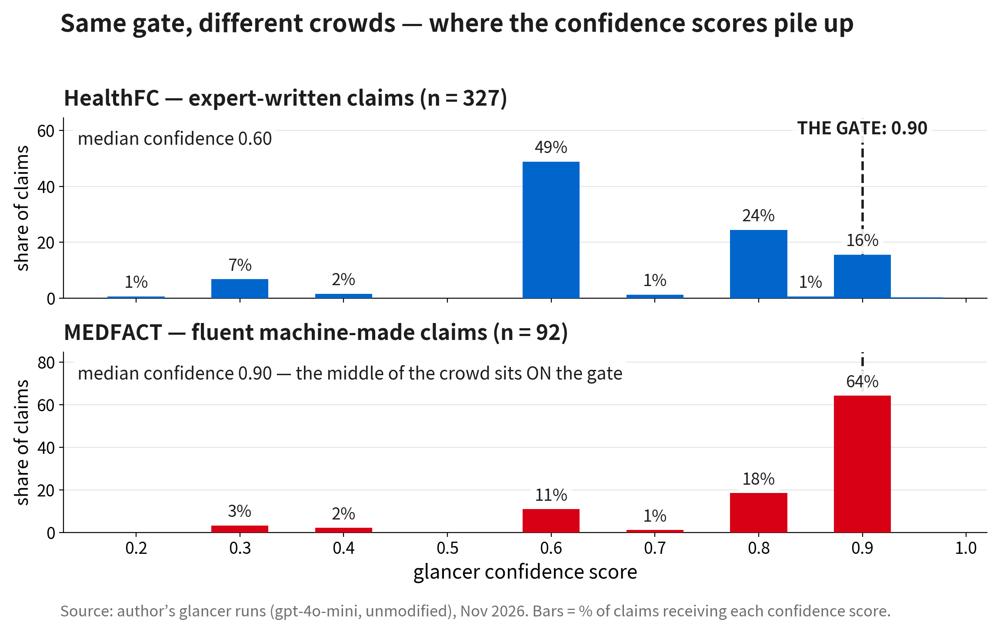

# External Validation — Results (November 6, 2026)

First systematic evaluation of the project's Tier 1 glancer on two published
benchmarks, run before the sweep on the project's own datasets. The glancer is
the prompted-LLM glancer from `agent/` (gpt-4o-mini via OpenRouter), used
**unmodified**: each claim is shown exactly once, with no retrieval and no
tools, and the model returns a verdict (`myth` / `true` / `mixed` / `unknown`)
plus a confidence.

## Protocol

- A `mixed` or `unknown` reply counts as an **abstention**, never as correct.
- Reported per set: strict accuracy, accuracy among decisive answers,
  per-direction accuracy, settle share + precision at the project's operating
  gate (confidence ≥ 0.90), and **coverage at 95% precision**, computed by
  sweeping a single confidence threshold over the decisive answers — i.e.,
  the coverage a real gate can achieve.
- Scoring code: `healthfc_eval.py`, `medfact_eval.py` in this folder.
  Full per-claim outputs: `results/healthfc_results.json`,
  `results/medfact_results.json`. Runs are resumable and were executed
  November 6, 2026.

> **Metric note.** Coverage at 95% precision is defined by the threshold
> sweep above. An earlier draft of the analysis code instead walked the
> confidence-sorted answer list and credited any prefix whose running
> precision reached 95%; that can split a group of answers sharing one
> confidence value and overstates what a threshold gate can achieve
> (it produced 0.315 / 0.043 on these runs). All figures below — and in the
> midway report — use the threshold sweep (0.165 / 0.000).

## HealthFC — 327 decisive claims (202 supported → true, 125 refuted → myth; NEI excluded)

```
claims scored            : 327
strict accuracy          : 126/327 = 0.385  (mixed/unknown counted as not correct)
decisive answers         : 137  (hedged/abstained: 190)
accuracy on decisive     : 126/137 = 0.920
  gold=true  accuracy : 104/106 = 0.981
  gold=myth  accuracy : 22/31 = 0.710
gate @0.90               : settles 52/327 = 0.159 of claims, precision 1.000
coverage @95% precision  : 0.165
```

## MEDFACT — balanced sample, 92 claims (46 supported → true, 46 refuted → myth)

The released MEDFACT training split is heavily skewed (3,386 supported vs.
46 refuted of 5,064 claims), so the sample takes all 46 refuted claims plus
46 supported claims drawn with seed 42. Labels map the dataset's
evidence-support relation onto claim verdicts at the two decisive poles only;
partially-supported / uncertain / not-applicable claims are excluded.

```
claims scored            : 92
strict accuracy          : 51/92 = 0.554  (mixed/unknown counted as not correct)
decisive answers         : 77  (hedged/abstained: 15)
accuracy on decisive     : 51/77 = 0.662
  gold=true  accuracy : 45/45 = 1.000
  gold=myth  accuracy : 6/32 = 0.188
gate @0.90               : settles 59/92 = 0.641 of claims, precision 0.712
coverage @95% precision  : 0.000
```

## Reading

| | HealthFC | MEDFACT (balanced) |
|---|---|---|
| Abstention rate | 58% | 16% |
| Accuracy on decisive answers | 0.920 | 0.662 |
| Myth identification (decisive) | 0.710 | 0.188 |
| Gate @0.90 settle share | 0.159 | 0.641 |
| Gate @0.90 precision | 1.000 | 0.712 |
| **Coverage @95% precision** | **0.165** | **0.000** |

On expert-phrased claims (HealthFC) the glancer abstains often and its gate
is safe. On fluent, textbook-style claims (MEDFACT) it commits confidently —
and is wrong: 26 fluent false claims were certified as true, several at
confidence 0.90, and **no threshold reaches 95% precision at any coverage**
(the pre-registered K3′ condition, met on this sample). Glancer confidence
tracks fluency and plausibility, not truth; delegation safety is a property
of the claim distribution, not of the gate alone. The final phase's key
measurement is the Tier 2 **rescue rate**: how often evidence-checking
overturns the glancer's confident errors.



**Figure — why the settle shares differ.** The gate is a fixed line at
confidence 0.90; what moves is where the glancer's confidence scores pile up.
On HealthFC the median confidence is 0.60 and 49% of claims sit at that one
value, far below the gate — only the tip of the distribution (15.9%) crosses
it. On MEDFACT the median confidence is 0.90 itself: 64% of claims land
exactly on the gate value, so the line cuts through the middle of the crowd
rather than above it. The settle share is therefore a property of the
confidence distribution, not of the gate: the gate is fixed, the
distribution moves with the dataset — silently.
